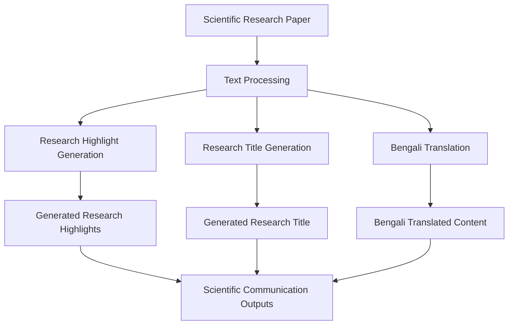

# 📚 Automating Scientific Communication
### Research Highlight Generation, Title Creation, and Bengali Translation

<p align="center">
  
  
  
  
  
</p>

---

## 📌 1. Project Overview

Scientific research papers contain valuable knowledge, discoveries, experimental findings, and technological innovations. However, understanding lengthy academic publications and extracting their most important contributions can be time-consuming.

**Automating Scientific Communication** is an AI-driven Natural Language Processing (NLP) project designed to simplify scientific information through automated text generation and multilingual translation.

The project integrates three major NLP tasks into a unified framework:

1. **Research Highlight Generation:** Automatically generates concise and meaningful highlights from scientific papers.
2. **Research Title Generation:** Generates relevant and informative titles based on scientific paper content.
3. **Bengali Translation:** Translates scientific information into Bengali to improve accessibility for Bengali-speaking readers.

The primary objective is to make scientific knowledge easier to understand, summarize, and access across language barriers.

## 🎯 2. Project Objectives

- Automate the generation of research highlights from scientific publications.
- Identify important research contributions and findings.
- Generate meaningful titles representing the central theme of scientific papers.
- Translate scientific content from English into Bengali.
- Reduce the manual effort required to understand lengthy research documents.
- Explore NLP and deep learning techniques for scientific text generation.
- Improve the accessibility of academic knowledge through multilingual communication.

## ❗ 3. Problem Statement

Scientific publications frequently contain lengthy explanations, complex terminology, technical descriptions, and detailed experimental results.

Extracting the most important information from these publications requires considerable time and domain knowledge.

Furthermore, manually creating research highlights and meaningful titles can be challenging. Language barriers also restrict access to scientific information for readers who prefer regional languages.

Traditional manual approaches are not always efficient for processing large volumes of scientific publications.

This project addresses these challenges by investigating automated approaches for:

- Generating concise research highlights.
- Creating contextually relevant scientific titles.
- Translating scientific information into Bengali.

## 💡 4. Proposed Solution

The proposed solution uses NLP-based text generation and translation techniques to automate three important scientific communication tasks.

The framework is organized into three independent but related subtasks.

### 4.1 Research Highlight Generation

Research highlights provide a concise representation of the important findings and contributions of a scientific publication.

This component focuses on generating short, informative highlights from scientific paper content.

**Expected functionality:**
- Process scientific paper text.
- Understand the central research information.
- Identify important findings and contributions.
- Generate concise research highlights.

### 4.2 Research Title Generation

A scientific title should represent the primary research topic and communicate the central contribution of a publication.

This component focuses on generating meaningful titles using the information contained in scientific papers.

**Expected functionality:**
- Process scientific paper content.
- Identify the central research theme.
- Understand the major research contribution.
- Generate an informative title.

### 4.3 Bengali Translation

Scientific information should be accessible to readers from different linguistic backgrounds.

This component focuses on translating scientific information from English into Bengali.

**Expected functionality:**
- Accept scientific text as input.
- Process the source-language content.
- Generate Bengali translations.
- Preserve the intended meaning of the original information.

## 🔄 5. System Workflow

The overall project follows a three-task scientific communication workflow.



**Workflow Explanation:**

1. Scientific paper content is provided as input.
2. The content is prepared for NLP processing.
3. The three subtasks process the relevant scientific information.
4. Research highlights and titles are generated.
5. Scientific content is translated into Bengali.
6. The generated outputs support simplified scientific communication.

*Note: This diagram represents the overall research framework, not a verified execution sequence of the notebook.*

## ✨ 6. Key Features

| Feature | Description |
|---|---|
| Research Highlight Generation | Generates concise summaries of important research findings. |
| Scientific Title Generation | Produces meaningful titles based on scientific content. |
| Bengali Translation | Converts scientific information into Bengali. |
| NLP-Based Processing | Uses natural language processing techniques for text understanding and generation. |
| Automated Text Generation | Reduces manual effort in preparing scientific content. |
| Multilingual Communication | Supports scientific information accessibility across languages. |
| Scientific Information Extraction | Focuses on important information contained in research publications. |

## 🛠️ 7. Technology Stack

The project follows a Python-based NLP and machine learning development workflow.

| Category | Technology |
|---|---|
| Programming Language | Python |
| Development Environment | Google Colab / Jupyter Notebook |
| AI Domain | Artificial Intelligence |
| Core Domain | Natural Language Processing |
| Machine Learning | Deep Learning and Text Generation |
| Data Processing | Python-based data processing |
| Model Development | Notebook-based experimentation |

**Important:** The exact Transformer architectures, pretrained models, Python libraries, and framework versions should be taken from the actual notebook implementation rather than assumed.

## 📂 8. Repository Structure

```text
Research-Highlight-Generation-from-Scientific-Papers/
│
├── sci-high/
│   │
│   ├── final_sci-high.ipynb
│   │
│   ├── Training Dataset
│   │
│   ├── Testing Dataset
│   │
│   ├── Model / Supporting Files
│   │
│   └── Experimental Results
│
└── README.md
```

The `sci-high` directory contains the main project implementation and associated research resources.

| Component | Purpose |
|---|---|
| `final_sci-high.ipynb` | Main notebook containing the project implementation and experiments. |
| Training Dataset | Data used for model development and training. |
| Testing Dataset | Data used for evaluating the developed approach. |
| Model / Supporting Files | Supporting resources required by the implementation, where applicable. |
| Experimental Results | Generated outputs and evaluation results, where available. |

*The dataset and supporting-file names above describe the project components; they are not confirmed literal filenames.*

## 💻 9. Prerequisites

Before running the project, ensure that the following are available:

- Python 3.x
- Google Colab or Jupyter Notebook
- Git
- Required Python libraries
- Project training and testing datasets
- Internet connectivity for downloading dependencies or pretrained models, if required

### Recommended Environment

Google Colab is a convenient environment for executing notebook-based machine learning experiments.

A GPU-enabled runtime can be selected when the implementation requires GPU acceleration.

## ⚙️ 10. Installation and Setup

Follow these steps to obtain the project and configure the development environment.

### Step 1: Clone the Repository

Open a terminal or command prompt and execute:

```bash
git clone https://github.com/AtharvY11/Research-Highlight-Generation-from-Scientific-Papers.git
```

### Step 2: Navigate to the Project Directory

```bash
cd Research-Highlight-Generation-from-Scientific-Papers
```

Navigate into the implementation directory:

```bash
cd sci-high
```

### Step 3: Verify Project Files

Check the available files:

```bash
ls
```

On Windows Command Prompt, use:

```cmd
dir
```

Locate the main notebook:

```text
final_sci-high.ipynb
```

### Step 4: Set Up Python Environment

Create a virtual environment:

```bash
python -m venv venv
```

Activate it on Windows:

```bash
venv\Scripts\activate
```

Activate it on Linux or macOS:

```bash
source venv/bin/activate
```

### Step 5: Install Dependencies

Install the dependencies required by the notebook.

If a `requirements.txt` file is available:

```bash
pip install -r requirements.txt
```

If no dependency file is provided, inspect the notebook imports and install the required packages.

For example, common scientific Python packages include:

```bash
pip install numpy pandas matplotlib scikit-learn jupyter
```

Additional NLP and deep learning packages must be installed according to the actual implementation.

### Step 6: Launch Jupyter Notebook

```bash
jupyter notebook
```

Open:

```text
final_sci-high.ipynb
```

Alternatively, upload the notebook to Google Colab.

## ▶️ 11. Execution Instructions

### Using Google Colab

1. Open Google Colab.
2. Upload `final_sci-high.ipynb`.
3. Select the appropriate runtime.
4. Configure the dataset paths.
5. Install the required dependencies.
6. Execute the notebook cells sequentially.
7. Observe the generated outputs and experimental results.

### Using Local Jupyter Notebook

1. Clone the repository.
2. Configure the Python environment.
3. Install the required dependencies.
4. Open the notebook.
5. Configure dataset locations.
6. Execute the cells sequentially.

**Important:** The exact execution order, dataset paths, and output locations must follow the instructions and code present in the notebook.

## 📊 12. Dataset Description

The project uses separate training and testing datasets for its research experiments.

### Training Dataset

The training dataset provides examples used during model development.

Its purpose is to support learning patterns and relationships between scientific text and the corresponding target outputs.

### Testing Dataset

The testing dataset is intended for evaluating the developed models using examples separate from the training data.

It helps assess the performance and generalization of the implemented approaches.

### Dataset Processing

Depending on the implemented pipeline, dataset preparation may involve:

- Loading the dataset.
- Inspecting available fields.
- Cleaning textual information.
- Handling missing values.
- Preparing input and target sequences.
- Tokenization.
- Preparing training and testing examples.

The actual preprocessing steps should be interpreted from the notebook implementation.

## 🧪 13. Experimental Evaluation

The project involves three distinct research tasks, and each should be evaluated according to its objective.

| Subtask | Evaluation Focus |
|---|---|
| Research Highlight Generation | Relevance, informativeness, and quality of generated highlights. |
| Research Title Generation | Relevance and semantic consistency of generated titles. |
| Bengali Translation | Translation quality, meaning preservation, and linguistic correctness. |

Possible evaluation approaches include:

- ROUGE
- BLEU
- BERTScore
- Human evaluation

These are potential evaluation methods, not claims that every metric has been implemented in this project.

Actual experimental scores should be reported only from verified results.

## 📤 14. Expected Outputs

The project is designed to produce three categories of scientific communication outputs.

### Output 1: Research Highlights

Concise textual highlights describing the important findings and contributions of a scientific paper.

### Output 2: Generated Research Title

A meaningful title representing the central theme of the scientific publication.

### Output 3: Bengali Translation

Bengali-language content intended to make scientific information accessible to Bengali-speaking readers.

The actual output format depends on the implementation of the notebook.

## ⚠️ 15. Troubleshooting

### Problem 1: ModuleNotFoundError

**Cause:** A required Python package is not installed.

**Solution:**

```bash
pip install package-name
```

Replace `package-name` with the missing dependency.

### Problem 2: FileNotFoundError

**Cause:** The notebook cannot locate the required dataset or supporting file.

**Solution:**
- Verify that the dataset has been downloaded.
- Check the dataset directory.
- Update the file path in the notebook.
- Ensure that the correct working directory is selected.

### Problem 3: CUDA or GPU Errors

**Cause:** GPU-related configuration or compatibility issues.

**Solution:**
- Verify GPU availability.
- Check the installed deep learning framework.
- Confirm CUDA compatibility where applicable.
- Use CPU execution if GPU acceleration is unavailable and the implementation supports it.

### Problem 4: Out of Memory

**Cause:** Available RAM or GPU memory is insufficient.

**Solution:**
- Reduce the batch size if configurable.
- Restart the notebook runtime.
- Release unused memory.
- Use a smaller model configuration if supported.

### Problem 5: Notebook Execution Issues

**Solution:**
- Restart the kernel or runtime.
- Execute cells in the correct order.
- Verify dependency installation.
- Confirm that all required input files are available.

## 🔮 16. Future Enhancements

Potential improvements to the project include:

- Supporting additional Indian regional languages.
- Improving the quality and contextual relevance of generated research highlights.
- Enhancing scientific title generation.
- Improving Bengali translation of technical terminology.
- Supporting direct PDF uploads.
- Developing a unified web-based scientific communication platform.
- Introducing interactive result visualization.
- Exploring advanced Transformer architectures.
- Integrating human feedback to improve generated content.

## 🤝 17. Contributing

Contributions and suggestions are welcome.

To contribute:

1. Fork the repository.
2. Create a new feature branch.
3. Implement your changes.
4. Test the implementation.
5. Submit a pull request with a description of your changes.

## 📄 18. License

No license information is currently specified in this repository.

If you intend to make the project open source, consider adding an appropriate license file.

## 👨‍💻 19. Author

**Atharv Yarandole**

MCA Student | Aspiring Software Developer | AI/ML & NLP Enthusiast

- GitHub: [AtharvY11](https://github.com/AtharvY11)
- Repository: [Research Highlight Generation from Scientific Papers](https://github.com/AtharvY11/Research-Highlight-Generation-from-Scientific-Papers)

---

<p align="center">
  <b>Automating Scientific Communication Through Artificial Intelligence.</b>
</p>

<p align="center">
  Developed with ❤️ by Atharv Yarandole
</p>
